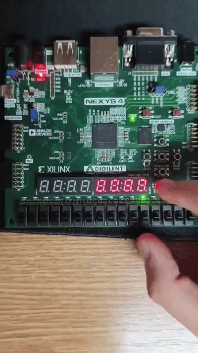
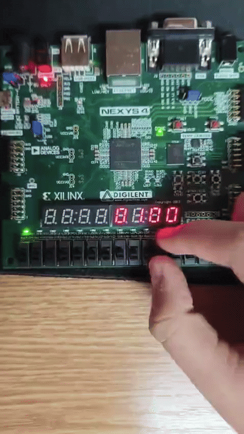
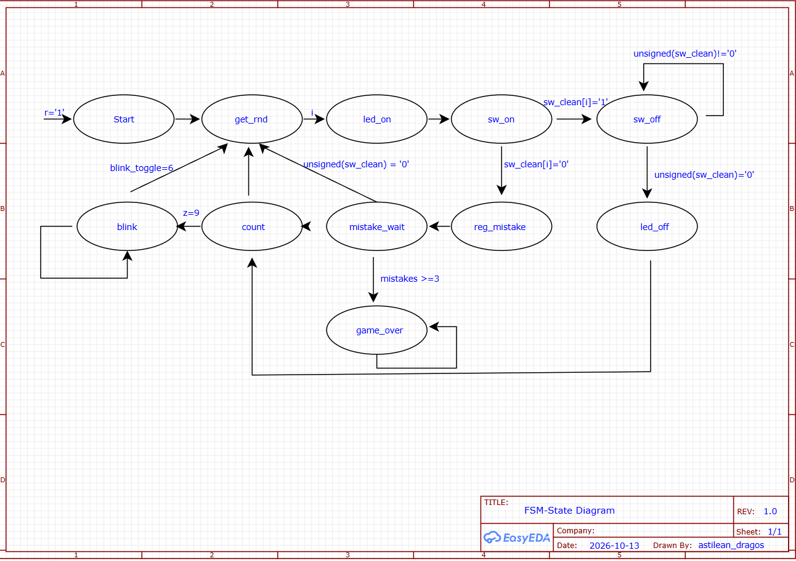

# FPGA Whack-a-Mole Game

A hardware implementation of the classic Whack-a-Mole game on the Digilent Nexys 4 FPGA board. This project focuses on state-machine-based game logic, pseudo-random target generation, and real-time hardware interaction.

## Gameplay Demo

**1. Gameplay & Scoring**  
The game generates random LED targets. A successful hit triggers a blinking animation and increments the player's score.  

**2. Game Over State**  
The game tracks missed targets and incorrect inputs. Upon reaching 3 mistakes, the game enters the "game over" state and displays the final score.  

## Tech Stack
- **Language:** VHDL
- **Hardware:** Digilent Nexys 4 (Artix-7)
- **Tools:** Xilinx Vivado

## Key Features & Architecture
- **Game Logic (FSM):** The core gameplay loop, state transitions, and mistake tracking are managed by a robust Finite State Machine.
- **Randomization (LFSR):** Uses a Linear-Feedback Shift Register to unpredictably generate the next LED target.
- **Input Handling:** Implements hardware debouncing logic for switches/buttons to ensure reliable and glitch-free user inputs.

### FSM State Diagram
The logic flow detailing the transitions between idle, target generation, waiting for input, and game over states:  

## How to Run
1. Open a new RTL project in Xilinx Vivado.
2. Import the VHDL source files and the Nexys 4 `.xdc` constraint file.
3. Run Synthesis, Implementation, and Generate Bitstream.
4. Program the FPGA board and start playing!
